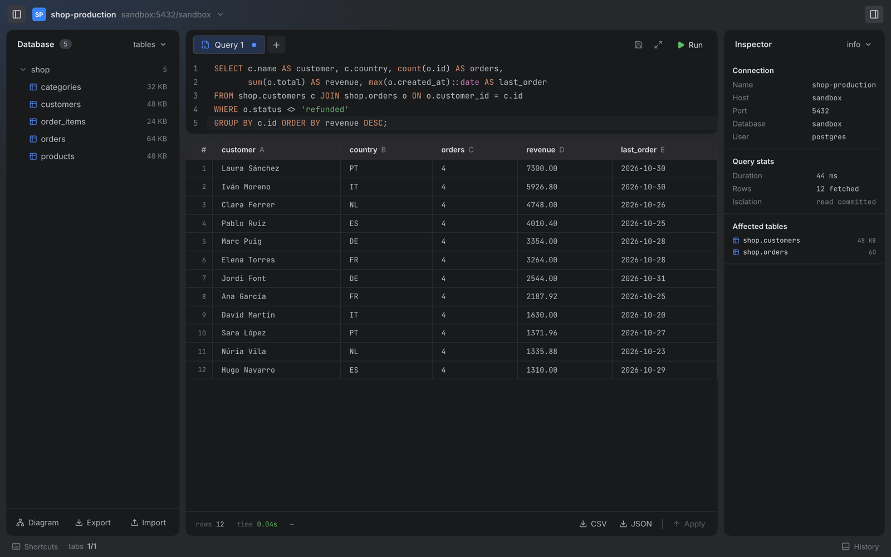
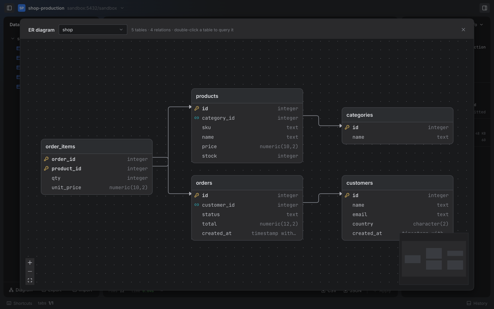
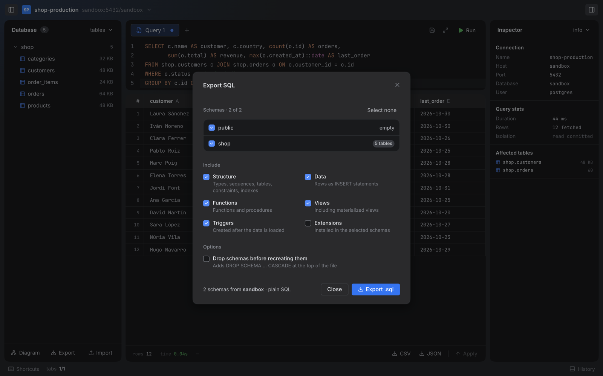
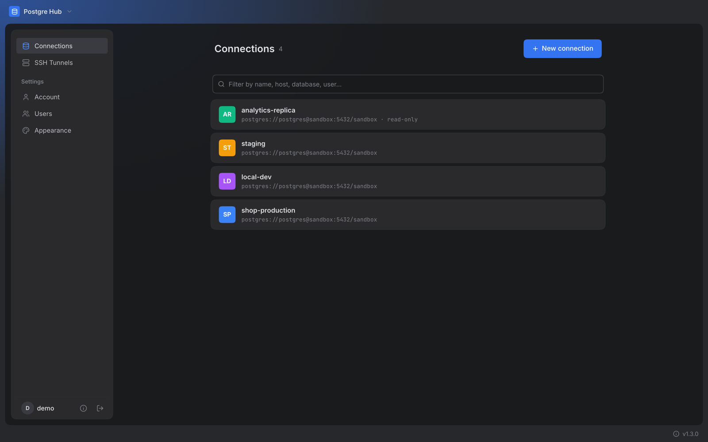

<h1 align="center">Postgre Hub</h1>

<p align="center">
  A self-hosted PostgreSQL admin in your browser.<br />
  Connections, SQL editor, schema browser, ER diagrams, SSH tunnels and SQL export / import — in a single binary.
</p>

<p align="center">
  <a href="https://github.com/towerforge/postgre-hub/releases/latest"></a>
  <a href="LICENSE"></a>
</p>

<p align="center">
  <a href="#quick-start">Quick start</a> ·
  <a href="#features">Features</a> ·
  <a href="#installation">Installation</a> ·
  <a href="#desktop-app">Desktop app</a> ·
  <a href="#configuration">Configuration</a>
</p>

<p align="center">
  
</p>

## Why Postgre Hub

- **One binary, no dependencies.** Download it, run it, open the browser. No cloud, no agents, no extra services.
- **Your data stays with you.** Saved connections, tunnels and users live in a local SQLite file you control.
- **Built for teams.** Multi-user login, with history and saved queries kept per user on the server.
- **Safe by default.** Read-only connections, per-connection query timeouts and a SQL preview before any inline edit is applied.

## Quick start

**Linux / macOS**

```bash
curl -fsSL https://raw.githubusercontent.com/towerforge/postgre-hub/main/install.sh | sh
postgre-hub
```

**Docker**

```bash
docker run -d --name postgre-hub -p 8080:8080 \
  -v postgre-hub-data:/data -e DATA_DIR=/data \
  towerforge/postgre-hub:latest
```

Open [http://localhost:8080](http://localhost:8080) and create the first user. More Docker options (Compose, volumes, upgrades) are in [DOCKER.md](DOCKER.md).

## Features

### SQL editor and results

CodeMirror editor with multiple tabs and autocompletion of schemas, tables and columns (aliases included: `o.` after `FROM orders o` lists the columns of `orders`). Run with `⌘⏎` / `Ctrl+⏎`, cancel a running query with **Stop**, inspect plans with `EXPLAIN` and watch live sessions.

Results open in a spreadsheet-style grid with inline editing — changes are shown as SQL before they run — and download as **CSV** or **JSON**. The inspector shows duration, rows and the tables a query touched.

### Schema browser and ER diagram

Browse tables, columns, types, sequences and routines of the active database. **Diagram** draws the tables of a schema with their keys and column types, and an arrow for every foreign key. Tables can be dragged, and double-clicking one opens it in a new query tab.

<p align="center">
  
</p>

### Export and import

Export any set of schemas to a plain `.sql` file, choosing what to include, and import `.sql` files back in a single transaction.

<p align="center">
  
</p>

### Connections and SSH tunnels

Store any number of PostgreSQL endpoints with SSL mode, a colour, a query timeout and an optional read-only flag. Define reusable SSH tunnel profiles (password or private key) and attach them to any connection; tunnels are opened on demand.

<p align="center">
  
</p>

### History and saved queries

Every run is kept on the server per user and connection (the latest 500). Any tab can be saved under a name and reopened later. Both are private to each user.

## Working with a connection

<details>
<summary><b>Running, cancelling and timeouts</b></summary>

Run the editor with **Run** or `⌘⏎` / `Ctrl+⏎`. While a query runs, the button turns into **Stop**, which cancels it on the server with `pg_cancel_backend`. Closing the tab or losing the connection also cancels it, so an abandoned query does not keep running.

*Query timeout* (seconds, `0` = no limit) is set in the connection form. It applies to queries and `EXPLAIN` run from the editor, not to export or import.

</details>

<details>
<summary><b>Read-only connections</b></summary>

With *Read-only* on, every transaction of that connection starts as `READ ONLY`: writes and imports fail with the PostgreSQL error, the result grid cannot be edited and the status bar shows a *read-only* badge.

This is a safety net against mistakes, not access control — a user can still run `BEGIN READ WRITE`. For a hard guarantee, connect with a database role that has no write privileges.

</details>

<details>
<summary><b>History and saved queries</b></summary>

The bottom panel (*History* in the status bar) has two tabs. *History* lists your last runs on this connection with time, duration, rows and errors. *Saved* holds named queries: rename a tab (double-click it) and press the save icon; saving again updates it.

</details>

<details>
<summary><b>Downloading results</b></summary>

**CSV** and **JSON** in the results footer download every row of the current result. CSV opens in Excel as UTF-8. In JSON, integers, floats, booleans and `json`/`jsonb` keep their types; `numeric` stays a string so no precision is lost.

</details>

<details>
<summary><b>Export and import in detail</b></summary>

Both actions live at the bottom of the schema sidebar. **Export** lets you pick:

- **Schemas** — all selected by default; system schemas are never listed.
- **What to include** — structure (types, sequences, tables, constraints, indexes), data, functions and procedures, views (including materialized views), triggers and extensions. Everything except extensions is on by default.
- **Drop schemas before recreating them** — adds `DROP SCHEMA … CASCADE` at the top of the file. Importing such a file deletes everything in those schemas on the target database first.

The file is ordered so it replays without dependency errors: tables, functions, column defaults, data, constraints, indexes, foreign keys, views and finally triggers. Statements that cannot be written as `IF NOT EXISTS` are wrapped so they are skipped when the object already exists, so a file can be imported over a database that already contains part of it. Sequence and identity counters are restored to their exported values.

**Import** accepts any `.sql` file, shows its first lines and runs it **in a single transaction**: if any statement fails, nothing is applied and the PostgreSQL error is shown. The schema sidebar reloads when it finishes.

Limits:

- The dump is built in memory; for multi-gigabyte databases use `pg_dump`.
- Domains, grants/ownership and comments are not exported.
- A view that depends on another view created later may fail on import.
- Uploads are limited to 512 MB. Behind a reverse proxy, raise its body size limit as well.
- A hand-written file that contains its own `COMMIT` ends the transaction at that point.

</details>

## Installation

Requires a network-reachable PostgreSQL 12+ instance.

**Linux / macOS** — the install script picks the right binary and installs it to `/usr/local/bin` when run as root, otherwise to `~/.local/bin`. Override with `POSTGRE_HUB_INSTALL_DIR=/your/path`.

```bash
curl -fsSL https://raw.githubusercontent.com/towerforge/postgre-hub/main/install.sh | sh
```

**Windows** — download the `.zip` from the [releases page](https://github.com/towerforge/postgre-hub/releases/latest), extract it (e.g. `C:\Program Files\postgre-hub\`) and run `postgre-hub.exe`, or add the folder to your `PATH`.

**Docker** — see [DOCKER.md](DOCKER.md). Images are published for `amd64` and `arm64`.

<details>
<summary><b>Pre-built binaries</b></summary>

All assets are on the [releases page](https://github.com/towerforge/postgre-hub/releases/latest).

| OS | Platform | Asset |
|---|---|---|
| Linux | x86_64 (glibc) | `postgre-hub-linux-x86_64.tar.gz` |
| Linux | x86_64 (static) | `postgre-hub-linux-x86_64-musl.tar.gz` |
| Linux | ARM64 (glibc) | `postgre-hub-linux-aarch64.tar.gz` |
| Linux | ARM64 (static) | `postgre-hub-linux-aarch64-musl.tar.gz` |
| Linux | ARMv7 | `postgre-hub-linux-armv7.tar.gz` |
| Linux | i686 | `postgre-hub-linux-i686.tar.gz` |
| macOS | Intel | `postgre-hub-macos-x86_64.tar.gz` |
| macOS | Apple Silicon | `postgre-hub-macos-aarch64.tar.gz` |
| Windows | x86_64 | `postgre-hub-windows-x86_64.zip` |
| Windows | i686 | `postgre-hub-windows-i686.zip` |

</details>

## Desktop app

Postgre Hub also ships as a native desktop application for macOS, Windows and Linux. It is the same server and the same UI as the browser version, wrapped in a window that uses the system webview (WebKit on macOS and Linux, WebView2 on Windows). There is no browser tab, no port to choose and nothing to keep running in a terminal.

**Install** — download the bundle for your system from the [releases page](https://github.com/towerforge/postgre-hub/releases/latest):

| OS | Asset |
|---|---|
| macOS (Apple Silicon / Intel) | `.dmg` (drag *Postgre Hub* to Applications) |
| Windows x86_64 | `-setup.exe` (per-user install) or `.msi` |
| Linux x86_64 / ARM64 | `.AppImage`, `.deb` or `.rpm` (needs WebKitGTK 4.1: Ubuntu 22.04+, Debian 12+) |

Until signed builds are published, macOS asks you to confirm the first launch in *System Settings → Privacy & Security*, and Windows SmartScreen shows a warning. To build it yourself, run `make desktop-build` (see [docs/desktop.md](docs/desktop.md)).

**Where your data lives** — the desktop app keeps its own `postgre-hub.db`, separate from any browser install:

| OS | Data directory |
|---|---|
| macOS | `~/Library/Application Support/com.towerforge.postgrehub/` |
| Windows | `%APPDATA%\com.towerforge.postgrehub\` |
| Linux | `~/.local/share/com.towerforge.postgrehub/` |

**Differences from the browser binary**

- The server listens on `127.0.0.1` only, on a port picked once and reused on later launches. It is never reachable from other machines, and requests with any other `Host` header are rejected.
- On first launch you create a user with a password, as usual. After that the app signs you in automatically when it starts; the password is only needed after signing out or when the session expires.
- Downloads (CSV, JSON, SQL exports) open the native *Save as* dialog.
- Only one window runs at a time: opening the app again focuses the existing window.
- `--port`, `--host`, `DATA_DIR` and the other environment variables do not apply. Use the browser binary or Docker for a shared, multi-user server.

## Configuration

```
postgre-hub [OPTIONS]

  -p, --port <PORT>   Port to bind to (default: 8080)
      --dev           Disable auth middleware — for local development only
```

| Variable | Default | Description |
|---|---|---|
| `DATA_DIR` | `.` | Directory where `postgre-hub.db` is stored |
| `SESSION_DURATION_HOURS` | `24` | Session lifetime in hours |
| `SECURE_COOKIES` | `false` | Adds the `Secure` flag to session cookies. Enable behind an HTTPS reverse proxy |

### Behind a reverse proxy

Postgre Hub does not terminate TLS. Put a reverse proxy (nginx, Caddy, Traefik…) in front of it when exposing it outside `localhost`, and set `SECURE_COOKIES=true` once it is served over HTTPS.

<details>
<summary><b>nginx</b></summary>

```nginx
location / {
    proxy_pass         http://127.0.0.1:8080;
    proxy_set_header   Host              $host;
    proxy_set_header   X-Forwarded-For   $proxy_add_x_forwarded_for;
    proxy_set_header   X-Real-IP         $remote_addr;

    # Allow importing large .sql files (nginx defaults to 1 MB)
    client_max_body_size 512m;
}
```

</details>

<details>
<summary><b>Caddy</b></summary>

```caddy
your.domain.tld {
    reverse_proxy 127.0.0.1:8080
}
```

</details>

## License

[MIT](LICENSE)
